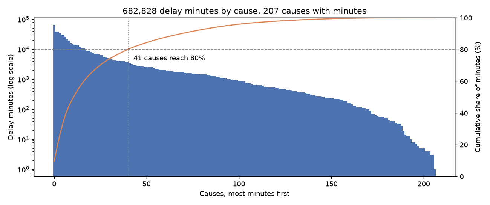
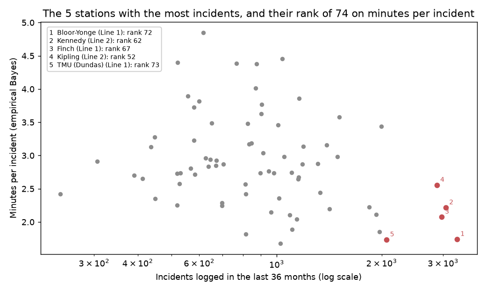

# TTC Subway Delay Analysis

Toronto publishes every logged subway delay since 2014 as open data. Once it's cleaned up, a small number of causes stand out: 41 of the 207 delay causes that cost any time make up 80% of the 682,828 minutes lost. This project downloads all of those files, cleans them into a DuckDB warehouse, computes the KPIs in SQL and feeds a Power BI report, so you can see which causes and stations to look at first.



The bars use a log scale, so the long tail looks bigger than it really is. The findings are written up for a non-technical reader in [FINDINGS.md](FINDINGS.md).

The other finding is about stations. Counting incidents points you at the wrong ones. The five stations that log the most incidents (Bloor-Yonge, Kennedy, Finch, Kipling and TMU) rank between 52nd and 73rd of 74 on minutes per incident over the last 36 months. Their incidents happen a lot, but they're short.



Both charts are drawn by `tools/plot_views.py` from the real-data exports. It needs matplotlib, which isn't in requirements.txt because the pipeline itself doesn't use it.

## Running it

You need Python 3.10 or later.

```bash
python3 -m pip install -r requirements.txt
python3 -m ttc_delay run --sample     # offline, on the committed sample
python3 -m ttc_delay all              # downloads every file through the CKAN API, then runs (about a minute)
python3 -m pytest -q                  # offline, about 6 seconds
```

`data/sample/` holds every 25th row of each real source file, with the original file names, sheets and layouts, so the whole pipeline runs without a network. A sample run ends with the data-quality checks:

```
[PASS] Row counts per year reconcile with the source files: 10,739 source rows = 10,739 loaded + 0 removed; ...
[PASS] No orphan foreign keys in fact_delay: 0 fact rows with a key missing from its dimension
[PASS] Station names resolved: 7 rows (0.07%) have a location that could not be matched; ...
[WARN] Delays over 600 minutes (kept, listed for review): 1 incidents
```

The real run writes the warehouse to `data/warehouse/ttc_delay.duckdb`, reports to `reports/` and the Power BI CSVs to `data/export/`. Opening the report needs Power BI Desktop on Windows. The setup steps, CLI options and some example queries are in [docs/usage.md](docs/usage.md).

## How it works

Most of the work was in the source files. Each era has its own layout: one sheet per month (and the sheet names change style every year), one sheet per year, then a CSV from 2025 on. Station names come in more than 2,000 spellings, things like "SCARB CTR STATIO" and "DUFFERIN STATON". Some cause descriptions had been encoded twice and came through as "–". The station cleaner strips the noise, applies a curated alias list, recognises yards, segments and line-wide entries, and only then tries fuzzy matching. Every fuzzy match I accepted or rejected is saved in `reference/`, so the same name never gets judged twice. In the end 267 rows (0.10%) stay unmatched.

The cleaned rows go into a star schema with one row per logged incident. Quality checks run on every build, and row counts reconcile with the source files for every year. The KPIs (cause Pareto, month-over-month, year-over-year, rolling 12 months) are SQL views. See [docs/warehouse.md](docs/warehouse.md).

Ranking stations by raw minutes per incident has its own flaw: a quiet station can top the list after one long delay. So each station's average is pulled toward its line's average with an empirical-Bayes model, in SQL, and each row comes with a sentence saying why the station moved. The model is in [docs/station-ranking.md](docs/station-ranking.md).

The Power BI report has four pages on a model of 28 DAX measures. Each measure names a SQL twin, and the tests check those twins against values worked out by hand on a 17-row dataset. Details in [docs/testing.md](docs/testing.md).

## Known issues

- The files have no ridership or service hours, so minutes per incident measures how bad incidents are, not how often they happen.
- Shrinkage fixes small samples, not one-off extremes. Glencairn and Woodbine top the last-12-month list because of a single ice-storm incident each. A heavy-tailed model is the obvious next step.
- About two-thirds of logged incidents record 0 minutes, and logging practice has changed, so compare minutes across years rather than incident counts.
- `tools/check_pbip.py` only checks the project files and references. It doesn't run the DAX, and the report isn't published to the Power BI service.

Data: City of Toronto, TTC Subway Delay Data, under the [Open Government Licence - Toronto](https://open.toronto.ca/open-data-license/) (the sample in `data/sample/` is redistributed under the same licence). Code: MIT.

Project period: 2026-02-16 to 2026-10-10.
